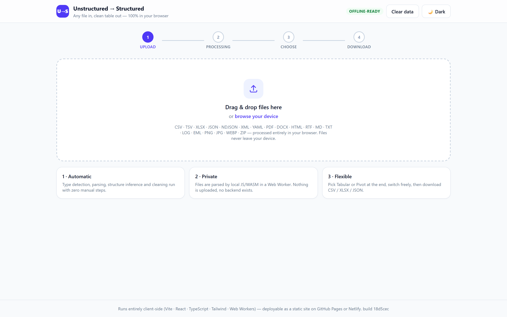
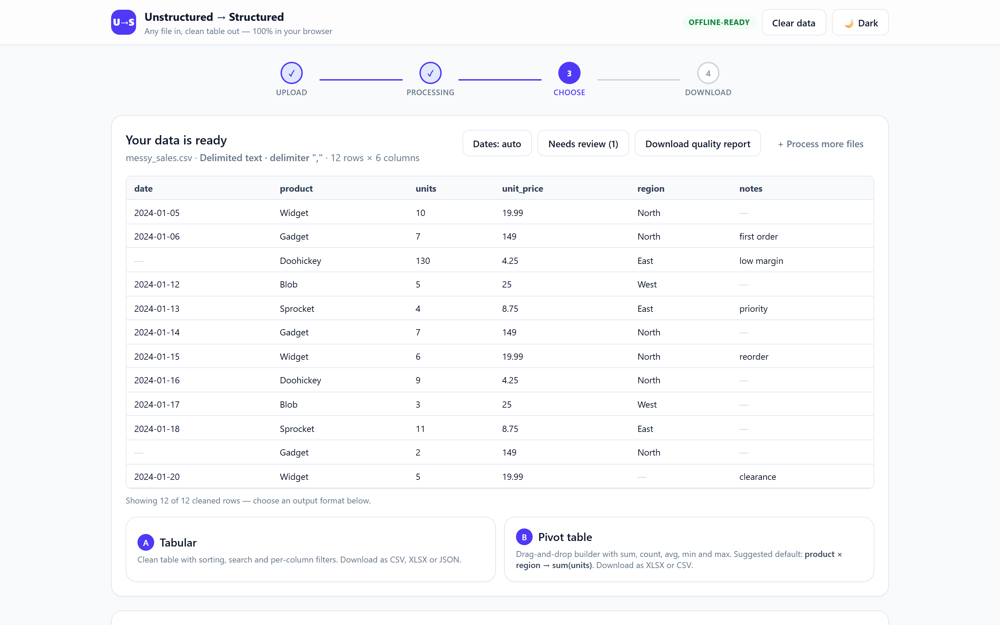
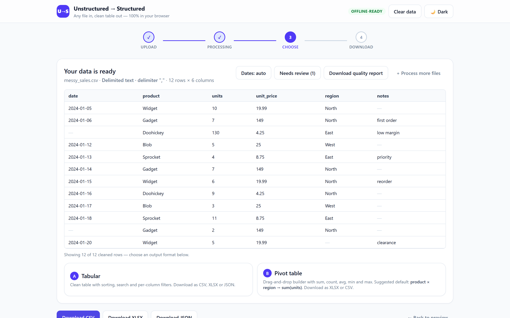
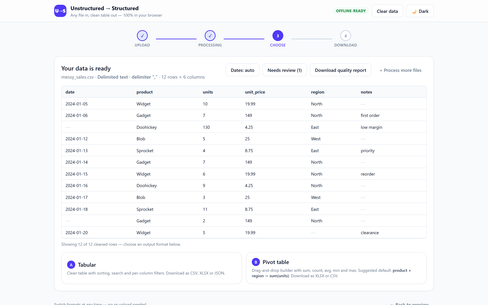
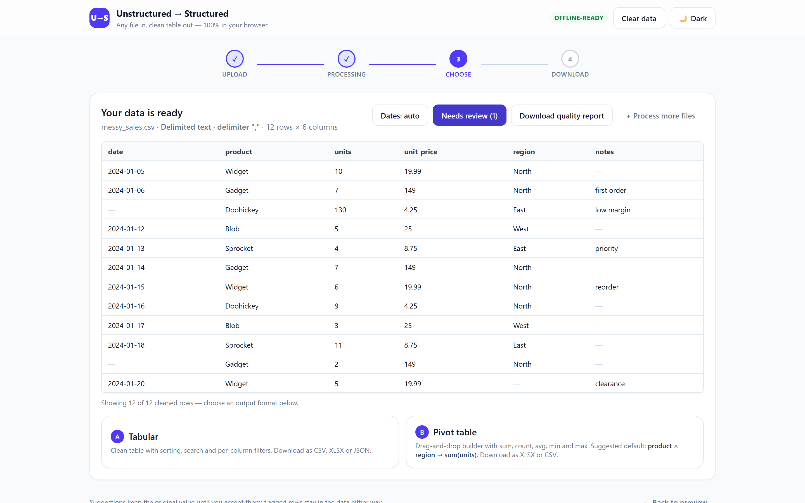
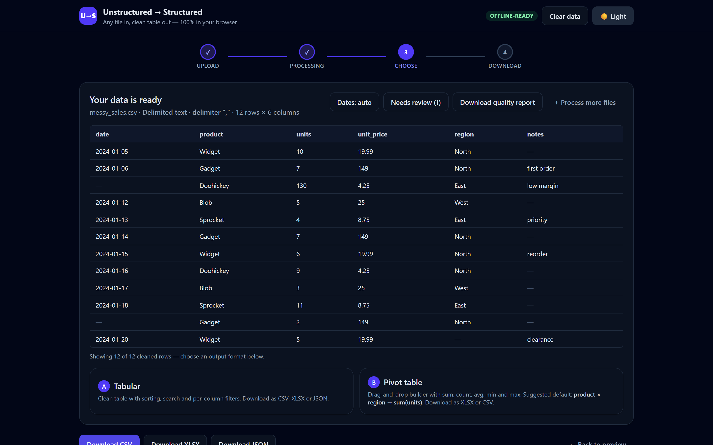
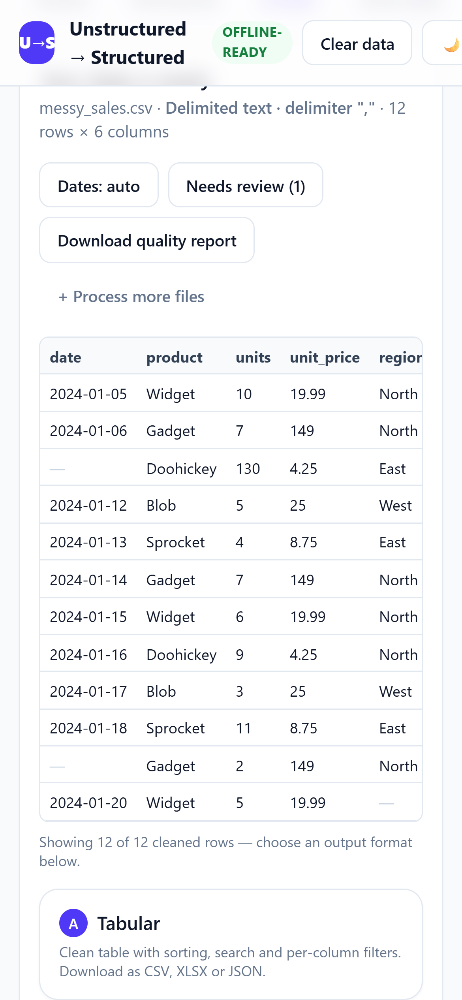

# Unstructured → Structured

**Beta (v0.x).** The pipeline is well tested, but the rules are still changing and the output
format may change with them. Do not treat it as a finished product, and read
[Known limitations](#known-limitations) before relying on a result.

A fully automated web app that turns **any file** into clean, structured data — then lets you
download it as a normal table or as a pivot table.

Upload a file, and the pipeline runs with **zero manual steps** until you reach the choice
screen. Nothing is uploaded anywhere: every byte is processed locally in your browser with
client-side JavaScript and WebAssembly.

> **No backend.** No servers, no API routes, no database. The build output is a folder of
> static files that runs from GitHub Pages, Netlify, S3, or `file://`.

**Live site:** <https://row-data-converter.vercel.app/> · the footer shows `build <git short
hash>` and `/version.json` returns the same hash with `Cache-Control: no-store`, so you can
always tell which commit is being served.

---

## Screens

| Upload | Preview → choose |
| --- | --- |
|  |  |

| Tabular | Pivot table |
| --- | --- |
|  |  |

| Needs review | Dark mode |
| --- | --- |
|  |  |

| Mobile upload (390 px) | Mobile tabular |
| --- | --- |
|  |  |

All screenshots are captured from the live site by `node e2e/screens.mjs`; that script also
writes the 1200×630 social card at `public/og.png`.

---

## Supported inputs

Files are auto-detected from the extension, MIME type and magic bytes:

| Category | Formats |
| --- | --- |
| Tabular | CSV, TSV, XLSX, XLS, JSON, NDJSON, XML, YAML |
| Documents | PDF (text + table detection), DOCX, TXT, MD, HTML, RTF |
| Images / scans | PNG, JPG, WEBP (Tesseract.js OCR → table reconstruction) |
| Logs & email | `.log`, `.eml`, key-value text |
| Archives | ZIP — every member is processed recursively |
| Anything else | Falls back to text extraction, then heuristic parsing |

The structuring stage detects delimiters, tables, `key:value` pairs and repeated patterns,
flattens nested JSON/XML into dot-notation columns, and extracts regex entities (dates,
emails, phones, amounts, IDs) from free text.

---

## Quick start

```bash
npm install
npm run dev
```

Open the printed local URL (default <http://localhost:5173>).

`npm install` runs `postinstall`, which copies the OCR engine into `public/tess/`. The
English OCR model (`public/tessdata/eng.traineddata.gz`) ships with the repo; if it is ever
missing, restore it with:

```bash
npm run prepare:assets   # copies the engine + downloads tessdata (network needed once)
```

---

## Scripts

| Command | What it does |
| --- | --- |
| `npm run dev` | Start the Vite dev server |
| `npm run build` | Type-check (`tsc -b`) and build `dist/` |
| `npm run preview` | Serve the production build locally |
| `npm test` | Run the full Vitest suite once |
| `npm run test:watch` | Run Vitest in watch mode |
| `npm run typecheck` | TypeScript project build, no emit |
| `npm run lint` | ESLint over the whole project |
| `npm run samples` | Regenerate the messy fixtures in `samples/` |
| `npm run hostile` | Regenerate the hostile corpus in `tests/hostile/` |
| `npm run prepare:assets` | Refresh OCR engine + language data into `public/` |
| `npm run deps:check` | Fail if the production dependency tree differs from `security/allowed-deps.json` |
| `npm run deps:record` | Re-record the reviewed dependency inventory |
| `npm run audit:prod` | `npm audit --omit=dev --audit-level=high` |
| `npm run scan:dist` | Fail on any unjustified origin or network call in `dist/` |
| `npm run verify-live` | Compare the deployed files with `dist/` byte for byte |

---

## How the pipeline works

Everything runs inside a **Web Worker**, so the UI stays responsive even on a 50 MB file, and
the main thread only renders a progress bar.

```
detect → extract → structure → clean → report → choose → download
```

1. **Detect** — identify the file type and encoding from magic bytes, extension and MIME.
2. **Extract** — pull raw text/tables/records with the right parser (SheetJS, pdf.js,
   mammoth, Tesseract.js, JSZip, DOMParser, …).
3. **Structure** — convert to rows and columns: delimiter/table detection from the **content**
   (S4, see below), key:value pairs, repeated patterns, entity extraction, nested-JSON/XML
   flattening.
4. **Clean** — the ten rules R1–R10 below. Outliers and oddities are **flagged, never
   silently deleted**.
5. **Quality report** — rows in/out/rejected, duplicates, nulls and conversions per column,
   ambiguous dates, flag counts, and the R10 reconciliation.

---

## Cleaning rules (R1–R10)

Every rule is generic — no column name is ever special-cased.

| Rule | What it does |
| --- | --- |
| **R1 Junk rows** | Title lines, export-date lines, blank rows, error rows (`ERR_*`, `SYSTEM ALERT`) and summary/total lines are moved to a **Rejected rows** table with a reason — never deleted silently. A total line is read as a control total for R10. |
| **R2 IDs** | A column that is mostly digits with variable prefixes/noise (`#`, `VIS-`, spaces, tags like `DUPLICATE?`) is stripped to the core ID. The untouched original stays in `<col>_raw`, the tag goes to a flag column. |
| **R3 Dates** | Day/month order is inferred **per format pattern** (separator + shape), not per column: if any value of a pattern has part 1 > 12 the pattern is DD-MM, part 2 > 12 makes it MM-DD, and the proven order is applied to that pattern's ambiguous values only. A pattern with no proof sets `date_ambiguous` and is read with the UI toggle (default **DD-MM**) — flipping the toggle re-runs the pipeline instantly. Dates after the file's export date get `date_future`. Output is ISO `YYYY-MM-DD`; `Mar 28 2026` and `17-Apr-2026` styles parse too. |
| **R4 Numbers** | `₹`, `Rs.`, `INR` and Indian grouping (`12,34,567`) parse to numbers. Text inside a numeric column (`"insurance pending"`) becomes `null` in the number and the text moves to `<col>_note`. `N/A`/blank → null. Text never survives in a numeric column. |
| **R5 Packed fields** | `key=value; key=value` cells split into separate columns (`patient_name`, `age`, `city`), and `A / B` or `A - B` cells split into two (`department`, `procedure`) — only when the pattern is consistent in ≥ 80% of cells. S5: the two halves of a composite may use **different separators from row to row** (`North - COMPLETED`, `Europe / completed`, `Asia | PENDING`); each cell must carry exactly one separator from `-`, `/`, `\|`, `:`, and the header names the halves. `Jean-Luc`, `10-12-2025`, `10 - 20` and `N/A` are never split. |
| **R6 Categories** | Trim, collapse spaces, ignore case, cluster variants and use the most frequent form as canonical. Status-like columns become `UPPER_SNAKE_CASE`; city/department become Title Case. Every before → after change is saved in the report's **Value mappings**. |
| **R7 Placeholders** | `"no extra notes"`, `N/A`, `none`, `-` become null. System-generated text (`SYSTEM NOTE: …`) moves to a `system_flag` column instead of the human notes column. |
| **R8 Duplicates** | After R2, exact duplicates are dropped and logged. Rows sharing an ID but differing in content are both kept with `duplicate_id_conflict = true`. People are never merged by name — repeated names are only counted. |
| **R9 Logic flags** | Flag only, never delete: `fee_on_cancelled_or_noshow`, `scheduled_in_past` (vs the export date), `paid_without_fee`, `age_missing`. |
| **R10 Reconciliation** | When the file has a total line, its value is compared with the sum of the parsed numeric column. Both numbers and the difference appear in the Quality Report (and its CSV/JSON download). |

The pipeline also carries later rules (R11–R18) for spelled-out numbers, multi-item cells,
overlapping categories and blank-row handling; `src/pipeline/rules.ts` is the source of truth.

### The table structure comes from the content (S4)

A real export is rarely made only of rows: it opens with a banner and an export date (padded
with whichever delimiter the export tool was configured with), and ends with an error line and
a control total. Counting those padding delimiters is how a six-row pipe table came out as one
text column. `src/pipeline/extract/sniff.ts` now reads the structure instead:

1. lines that are not table lines are classified first — blank, delimiter-only padding, and
error / metadata / summary / footer lines;
2. every candidate delimiter (`,` `;` TAB `|`) is scored only on the lines that carry it at
least twice: the modal field count and how many lines agree with it;
3. the (delimiter, field count) with the most agreeing lines wins, ties go to more columns, so
`…,,,` can never vote for the comma;
4. lines that do not fit become **Rejected rows** with a reason (a row shorter than the table
is a row with missing trailing cells and is padded, never shifted);
5. when no delimiter passes, the file is read as Plain text (or by the text ladder: Markdown
table, log lines, key:value, repeated pattern).

The **extension decides nothing**: the same bytes named `.txt`, `.csv`, `.tsv`, `.dat` or with
no extension produce the same table, which `tests/pipe-export.test.ts` asserts byte for byte.
`tests/text-shapes.test.ts` guards the other direction: prose with commas, a key:value config, a
log file and a Markdown table keep their own readers.

> Rules R1–R10 are described below; the later ones are additive and never delete rows.

The **Needs review** tab lists every row carrying a flag — ambiguous dates, future dates, id
conflicts, logic flags, system notes — with a per-flag filter. It is a review queue: the clean
data itself is unchanged.

---

## Pivot rules (P1–P9)

| Rule | What it does |
| --- | --- |
| **P1 Order of operations** | The pivot is always built from the **final cleaned dataset** (after R1–R10). Any setting change — including the R3 date toggle — rebuilds it from the new clean data. |
| **P2 Axis check** | Before building, every row/column axis is checked for values that differ only by case, spacing or punctuation; those are re-canonicalised first. A pivot never splits `Paid` / `PAID` / ` paid `. |
| **P3 Empty vs zero** | An empty cell means *no records*; `0` means *records exist and sum to zero*. The **“Show 0 for empty cells”** toggle defaults to off. |
| **P4 Hidden rows** | A banner reports *“N of M rows have no value and are not included in this sum.”* The **Sum + Count** mode adds a second pivot of row counts so hidden rows are visible. |
| **P5 Totals** | One label, **Total**, for both the total row and the total column; in XLSX those cells carry a `total` marker instead of being ordinary values. CSV has an **Include totals** option (default on). Every download is verified first — row totals, column totals and grand total must reconcile or the download is blocked with an error. |
| **P6 Flagged-row share** | When a flag column exists, a banner shows *“31.3% of this total comes from rows flagged: fee_on_cancelled_or_noshow”* with an **Exclude flagged rows** toggle that rebuilds the pivot. |
| **P7 Number format** | The UI shows Indian grouping with 2 decimals; CSV and XLSX carry plain numbers rounded to 2 decimals, with no currency symbols. |
| **P8 Pivot info** | The pivot XLSX ships a **Pivot info** sheet: source file, row field, column field, value field, aggregation, filters applied, rows used, rows excluded (null value), rows excluded (flagged) and the reconciliation result. The CSV stays machine-clean (header + data only). |
| **P9 Default pivot** | Two categorical columns with 3–12 values each are chosen for rows × columns plus a numeric column for the sum; the top **2 suggestions** are shown as one-click buttons. |

---

### Choosing an output

At the choice screen you can switch between **Tabular** (sortable, searchable, filterable
table) and **Pivot** (drag-and-drop rows/columns/values with sum, count, avg, min, max) — and
back again — **without re-uploading**. A sensible default pivot is suggested automatically,
and the **Needs review** tab sits beside them.

The **Dates: DD-MM / MM-DD** button re-runs the whole pipeline on the already-loaded files
whenever you change your mind about ambiguous dates (R3).

Downloads are generated entirely in the browser with `Blob` + `URL.createObjectURL`:

- **Tabular** → CSV, XLSX (multi-sheet: *Clean data*, *Rejected rows*, *Quality report*,
  *Value mappings*), JSON
- **Pivot** → XLSX (*Pivot* + *Pivot info*), CSV (with an *Include totals* option)
- **Quality report** → CSV, JSON

---

## Testing

```bash
npm test
```

Twenty suites, 144 tests:

| Suite | Covers |
| --- | --- |
| `tests/hospital.test.ts` | **Acceptance suite** — R1–R10 and P1–P9 against `samples/hospital/raw.csv` |
| `tests/parity.test.ts` | **Production bundle parity** — every sample through `vite preview` in headless Chromium, CSV compared byte for byte with the Node pipeline |
| `tests/privacy.test.ts` | Privacy charter, measured in Chrome: zero cookies/storage/caches/workers after a full session (A), every request a same-origin `GET` with no body and no beacon/WebSocket/EventSource (E), a canary from a cell and a filename appearing only in the DOM and the download (F) |
| `tests/sw-cleanup.test.ts` | A browser still holding the old `91ed3d7` worker is cleaned on the next load: registrations, caches and preferences gone |
| `tests/offline-browser.test.ts` | Every sample converts with the network switched off in an already-open page: no request fails, and every request the page still makes is a same-origin asset answered from the browser's cache |
| `tests/static-hosting.test.ts` | No `api/`, no `functions/`, no analytics or telemetry package, `installCommand` set, and every file in `dist/` has a static file type |
| `tests/determinism.test.ts` | Byte-identical CSV/XLSX/report/pivot output across four time zones and four locales |
| `tests/date-toggle.test.ts` | R3 toggle: ambiguous dates really change, dates proven by the data do not |
| `tests/pipeline.test.ts` | Every sample file converts to a clean table automatically |
| `tests/pipe-export.test.ts` | **S4/S5 regression** — the pipe export inside comma padding and junk lines: six rows, ids, dates, amounts, the TOTAL reconciliation, the packed details, the mixed-separator composite column, every rejected line; and byte-identical output under five file extensions |
| `tests/text-shapes.test.ts` | **S4 negative controls** — prose with commas, a key:value config, a log file and a Markdown table keep their strategies (also under a `.csv` name) |
| `tests/ocr.test.ts` | Scanned-image OCR → reconstructed table |
| `tests/pivot.test.ts` | Auto-suggestion and all five aggregations |
| `tests/export.test.ts` | CSV / JSON / XLSX round-trips through real parsers |
| `tests/offline.test.ts` | No external origins in source or in the built entry HTML |
| `tests/fuzz/accuracy.test.ts` | Randomised datasets through a generator/injector harness: parse what was injected, clean what was dirtied, without over-cleaning what was already clean |
| `tests/fuzz/smoke.test.ts` | The fuzz entries themselves stay tractable |
| `tests/helpers.ts` | Shared sample-loading fixtures |

`tests/parity.test.ts` exists because the unit tests run in Node while production runs
in a browser worker, and that gap hid a live defect: mammoth's **browser** build reads
`options.arrayBuffer` while its **Node** build reads `options.buffer`, so every `.docx` failed on the
deployed site with a green suite. The parity suite now runs each sample through the built bundle
and fails on a single differing byte.

### Dependencies with separate browser and Node builds

Vite resolves the `browser`/`module` entries, Vitest and Node resolve `main`/`exports`. Any
package that branches on the environment is a place where the two can disagree:

| Package | Node build (tests) | Browser build (deployed) | Consequence |
| --- | --- | --- | --- |
| `mammoth` | `lib/unzip.js` — reads `options.buffer` | `browser/unzip.js` — reads `options.arrayBuffer` | Every `.docx` failed live; `src/pipeline/extract/docx.ts` now supplies both keys |
| `jszip` | `lib/index.js` with `readable-stream` shim | `dist/jszip.min.js` | ZIP extraction is only proven in the browser by the parity suite |
| `papaparse` | `papaparse.js` | `papaparse.min.js` | Same parser, minified |
| `pdfjs-dist` | `build/pdf.mjs`, with `fs`, `canvas`, `http`, `url` available | the same modules mapped to `false` | pdf.js takes its fetch/canvas path in the worker; `pdf.worker.min.mjs` is precached |
| `tesseract.js` | `src/worker/node/index.js` | `src/worker/browser/index.js` | The OCR unit test runs in the Node environment; the browser worker path is covered by the live run |
| `xlsx` | `xlsx.js` (CommonJS, `crypto` available) | `xlsx.mjs` (`crypto`, `fs`, `buffer`, `stream` disabled) | Date cells: the reader now decides date vs date-time from the cell's rendered text instead of a timezone-dependent `Date` |
| `react-dom` | `server.js` | `server.browser.js` | `server.*` is not imported at runtime |

Neither build is "the" build — they are different code paths for the same feature, which is why
every input type is exercised in the browser before a deploy.

Correctness is not judged by eyeballing output. The hospital suite pins exact numbers from a
real messy export, and the fuzz suite builds datasets from a known-clean source, injects the
kinds of damage real exports contain (junk rows, mixed date orders, currency noise, packed
cells, duplicates, casing variants), then asserts that every cell that was *not* damaged is
preserved and every cell that *was* is recovered. A rule that fixes one case by breaking
another fails there.

### The hospital regression sample

`samples/hospital/` holds a real messy export used as the regression test for the rules:

| File | What it is |
| --- | --- |
| `raw.csv` | 1001 data lines plus title, export-date, error, alert, blank, `TOTAL …` and `Export generated` junk lines; packed `patient=…; age=…; city=…` and `dept / procedure` cells, `#`/`VIS-` id prefixes, mixed `MM-DD-YYYY` and `DD/MM/YYYY` dates, `N/A` fees, casing variants, duplicates |
| `current_output.csv` | Reference of what the app produced before the patch |
| `current_pivot.csv` | Reference of the pre-patch pivot |

The suite asserts, among others: 999 clean rows and 7 rejected rows with reasons; dash dates
read as MM-DD (`02-12-2025` → `2025-02-12`) while slash dates stay DD/MM (`06/02/2026` →
`2026-02-06`); zero future dates; `fee_inr` 751 numeric / 248 null with 29 `insurance pending`
otes; 15 cities, 8 departments, ≤ 32 department+procedure combinations, 6 statuses and 5
payment statuses in upper case; 27 `system_flag` rows; 228 `fee_on_cancelled_or_noshow`
flags; and a reconciliation of 4 668 696.06 parsed vs 4 287 650.00 reported (difference
381 046.06). The pivot half checks all 30 cells, every row/column total, the 4 668 696.06
grand total, the 248/999 hidden-row banner, the 751 count total, the 31.3% flagged share and
the 3 206 869.46 total after excluding flagged rows.

`samples/dev/pipe_sales_export.txt` is the second hand-checked fixture: a six-row pipe table
with `,,,` padding, a banner, an export date, an `ERR_ROW_…` line, two blank lines, a `TOTAL …`
line, packed `name=…; age=…; city=…` details, four date formats, currency, `N/A` and a
`Region / Status` column that uses ` - ` and ` / ` in different rows. Its expected values are
derived by hand (the amounts sum to the file's own total), never snapshotted from the app.

`npm run samples` regenerates the 22 messy fixtures in `samples/` — a messy CSV, nested JSON,
a PDF with a table, a scanned image, a DOCX, a log file, a ZIP and more, including a
deliberately gnarly real-world export.

> **Note:** `tests/ocr.test.ts` declares `// @vitest-environment node`. Under jsdom,
> tesseract.js treats filesystem paths as URLs and percent-encodes spaces in them, so its
> worker thread cannot load. The OCR test therefore runs in a real Node environment — in the
> browser this problem does not occur because the worker path is a plain same-origin URL.

---

## Build & deploy

```bash
npm run build
```

The output is a self-contained static site in `dist/`. Vite is configured with
`base: './'`, so the app works from any sub-path (e.g. GitHub Pages project sites).

### Vercel

To turn on the deploy gate, add one repository variable — **Settings → Secrets and variables →
Actions → Variables → New repository variable**, name `LIVE_URL`,
value `https://row-data-converter.vercel.app`. While it is unset the `verify-deploy` job still
runs and posts a `LIVE_URL is not set` warning annotation, so a skipped deploy check is visible
in the Actions summary instead of looking like a pass.

The live site deploys from `main` with `vercel.json`:

- **Build command:** `npm run build` · **Output:** `dist` · **Node:** 22 (`engines.node`)
- **Install command:** `npm ci --ignore-scripts` — a dependency's install hook cannot run
  during a deploy. **Build command:** `npm run build` · **Output:** `dist` · **Node:** 22
  (`engines.node`)
- SPA fallback rewrite to `/index.html`, except `/version.json`, `/integrity.json`,
  `/robots.txt`, `/sw.js`, `/assets/`, `/tess/`, `/tessdata/`
- `/version.json` and `/integrity.json` served as JSON with `Cache-Control: no-store`;
  `/sw.js` with `no-store` so the tombstone below is fetched
- `/assets/` served `immutable` for a year (the names are content-hashed), `/tess/` and
  `/tessdata/` for a year. This is what replaces the old worker if the network goes away
  mid-session: pdf.js's worker script and the OCR engine are re-requested by a fresh engine
  worker on each conversion, and the browser answers them from its HTTP cache.
- CSP `default-src 'none'` with explicit allows (`script-src 'self' 'wasm-unsafe-eval'`,
  `style-src 'self'`, `img-src 'self' data: blob:`, `font-src 'self'`, `media-src 'self'
  data: blob:`, `worker-src 'self' blob:`, `connect-src 'self'`, `manifest-src 'self'`),
  `form-action 'none'`, `base-uri 'none'`, `frame-ancestors 'none'`, `object-src 'none'`,
  and Trusted Types (`require-trusted-types-for 'script'; trusted-types u2s-worker`).
  `Referrer-Policy: no-referrer`, `X-Content-Type-Options: nosniff`, `X-Frame-Options: DENY`,
  and a `Permissions-Policy` that denies camera, microphone and geolocation

Why those are the only loose directives: `'wasm-unsafe-eval'` is required by the vendored
Tesseract engine; `blob:` is how the app hands a `File` to its worker and how a download is
built and revoked; `data:` covers the inline favicon; `blob:` in `worker-src` is the
module-worker constructor. `style-src` is self-only rather than nonce-based because React
writes element styles through CSSOM, which CSP does not police either way. Everything
else — remote scripts, fonts, frames, forms, objects and outbound connections — is denied
by `default-src 'none'`.

The build stamps itself: Vite injects the git short hash and ISO timestamp, writes
`dist/version.json`, and adds `<meta name="build">`. After a push, CI polls the live
`/version.json` and **fails if its hash is not the commit that was just built** — so a stale or
un-connected deployment cannot pass silently.

### Netlify

- **Build command:** `npm run build`
- **Publish directory:** `dist`

Or drag-and-drop the `dist/` folder onto Netlify Drop.

### GitHub Pages

```bash
npm run build
# then publish dist/ with your preferred action, e.g. peaceiris/actions-gh-pages,
# or point Pages at a branch containing only the dist/ contents
```

Any other static host works the same way: publish `dist/`, no server required.

---

## Offline & privacy

- Files never leave the device — there is no upload endpoint to leave through.
- After the page loads, the app makes **no network requests**: OCR and PDF engines are
  vendored into `public/`, not loaded from a CDN. `npm test` asserts this.
- The only script that touches the network is `scripts/fetch-ocr-data.mjs`, which runs at
  setup time to restore language data.
- **Clear data** in the header drops the loaded results and empties `localStorage`,
  `sessionStorage`, IndexedDB, the Cache API and any service-worker registration. There is
  no preference to keep: the theme follows the operating system and an in-session toggle
  is forgotten on reload.
- **There is no offline reload.** Without a service worker a page cannot be reopened with
  the network down. What does hold is that an *already open* page keeps converting every
  supported file type with the network off (`tests/offline-browser.test.ts` warms each
  parser and the OCR engine online first, then asserts zero requests are attempted).

### Threat model

This is a local data tool. It is built so that a hostile *file* is the only thing
that can attack it, and so that the person using it can verify the privacy claim
instead of trusting it.

**What it protects against**

| Threat | Defence |
| --- | --- |
| The file being uploaded to a server | There is no server. The app is static files; every parser runs in this tab or in a Web Worker, and `connect-src 'self'` plus the dist scan (`npm run scan:dist`) refuse and detect any call out. |
| A file executing script in the page (XSS via CSV/XLSX/HTML/SVG/DOCX) | Cell values are rendered as React text nodes only; the project bans `dangerouslySetInnerHTML`, `innerHTML`, `outerHTML`, `insertAdjacentHTML`, `document.write`, `eval`, `new Function` and `javascript:` URLs in ESLint, and the CSP additionally requires Trusted Types. `tests/hostile-browser.test.ts` uploads 30 hostile files to the built app in Chrome with a canary: no script may run. |
| A formula in a cell running in Excel / Sheets | Text columns are neutralised on export (`'=`, `'+`, `'-`, `'@`, tab, CR) unless *Spreadsheet-safe export* is turned off; XLSX text is written as string cells, never as formulas. |
| Zip bombs, billion laughs, XXE, 10 000-deep nesting, 50 MB lines, 1 M columns | Explicit limits, checked from the file header where possible, with a readable message instead of a frozen tab — see [Limits](#limits). |
| ReDoS in the cleaning heuristics | The regex-driven heuristics only run on text under `heuristicChars` (2 MB) and use no nested quantifiers. |
| A poisoned dependency or a modified deploy | `npm ci --ignore-scripts`, a reviewed production inventory, an audit gate, a pinned-action CI, and a published SHA-256 manifest of every deployed file (`npm run verify-live`). |
| A filename that lies about itself (`invoice\u202Ecod.exe`) | Download names are NFKC-normalised, stripped of path separators, control characters, bidi overrides and zero-width characters, and length-capped. |

**What it cannot protect against**

- **A compromised device.** Malware, a malicious browser extension, or someone with
  access to the machine can read the file, the tab, and the download.
- **The downloaded file itself.** Once you download a CSV or XLSX, the spreadsheet
  application that opens it is outside this app's control. That is why the export
  neutralises formulas and why the in-app notice tells you to delete the download on a
  shared computer.
- **A compromised or malicious deployment.** The integrity manifest proves the files
  are the ones this repository built; it cannot prove the repository is honest. Build
  it yourself if that matters — see [Maximum privacy mode](#maximum-privacy-mode).
- **Denial of service by the operating system.** Limits stop a browser tab from
  freezing; they do not stop a 200 MB file from being slow to read off disk.
- **Your own typing.** Anything you paste into the app is in this tab, and in the
  clipboard history of the machine.

### Limits

Measured from the file itself where possible (ZIP central directory, image header)
before any expensive work starts. Each limit throws a message written for a person,
and the app shows it verbatim. The numbers live in one place, `src/pipeline/limits.ts`.

| Limit | Value | Where |
| --- | --- | --- |
| One file | 200 MB | UI + pipeline |
| Uncompressed archive contents (all members) | 300 MB | `extract/archive.ts` |
| Archive compression ratio | 200:1 | `extract/archive.ts` |
| Files in one archive | 2 000 | `extract/archive.ts` |
| Archives inside archives | 3 | `extract/archive.ts` |
| JSON/object nesting depth | 256 | `limits.ts` (`maxJsonDepth`) |
| XML element depth | 256 | `limits.ts` (`maxXmlDepth`) |
| Longest single line | 2 MB | `limits.ts` (`assertLineLengths`) |
| Columns | 4 096 | `limits.ts` |
| Rows | 2 000 000 | `limits.ts` |
| Image pixels before OCR | 40 MP | `limits.ts` (`imageSize`, header only) |
| Text handed to the regex heuristics | 2 MB | `limits.ts` |
| DOCTYPE / entity declarations | refused outright | `limits.ts` (`assertNoDoctypeEntities`) |

The corpus that exercises these lives in `tests/hostile/` and is regenerated by
`npm run hostile` (no downloads): XSS payloads in every text format, prototype-polluting
keys, XXE and billion-laughs XML, a zip bomb, 10 000 archive entries, a deeply nested
archive, 10 000-deep JSON and XML, a 50 MB single line, a 1 M-column CSV, ReDoS strings,
a 100 MP image, and RTL/control-character filenames.

### Rendering safety

There is no raw-HTML sink in `src/` — grep for `dangerouslySetInnerHTML`, `innerHTML`,
`outerHTML`, `insertAdjacentHTML`, `document.write`, `eval`, `new Function` or `srcdoc`
and the only hits are the lint rules that ban them. File text reaches the DOM as a React
text node, so markup in a cell is shown, never parsed. The lint rules are errors, so CI
fails on the first reintroduction.

The CSP in `vercel.json` sends `require-trusted-types-for 'script'; trusted-types u2s-worker`
with the **document** (and every path the SPA rewrite can serve). It was kept only after the
full browser suite passed with it. Turning it on initially broke the app in a way worth
recording: `new Worker(url)` and `serviceWorker.register(url)` refuse a plain string under
this policy, so both now mint their URL through one narrow policy (`src/lib/trusted.ts`)
that only produces same-origin `.js`/`.mjs` URLs. The conversion worker is emitted with
Vite's `?worker&url` so its filename is known before the policy mints it.

The engine paths (`assets/`, `tess/`, `tessdata/`) are served a CSP **without** the Trusted
Types directives. They are scripts and wasm, not documents, and they are the one place the
policy cannot reach: `tess/worker.min.js` is a third-party worker script that calls
`importScripts()` from a plain string inside its *own* global, where no policy of ours
exists. The document, which is where an injected string would become markup or a script, is
fully covered; a script URL inside the OCR engine is already constrained by
`script-src 'self'` and `worker-src 'self' blob:`.

One consequence for the engines: tesseract.js normally re-wraps its worker script in a
`blob:` URL; `workerBlobURL: false` uses the same-origin, service-worker-cached
`/tess/worker.min.js` instead.

### Spreadsheet-safe export

CSV and XLSX exports neutralise spreadsheet formulas by default: a cell in a **text**
column that starts with `=`, `+`, `-`, `@`, tab or CR is prefixed with a single quote.
Numeric and date columns are left untouched, so `-2+3` in an amount column stays a
number. XLSX text is always written as a string cell, never as a formula, so
`=HYPERLINK("https://x","y")`, `=cmd|' /C calc'!A0`, `@SUM(1+1)`, `+1+1` and `-2+3` all
arrive as literal text. The Quality Report states how many cells were neutralised.

**Trade-off:** a text cell that genuinely begins with `-` or `+` gains a leading quote in
Excel-compatible tools. Turn *Spreadsheet-safe export* off in the output panel when the
file is not going to a spreadsheet.

### Dependency and supply-chain gates

| Gate | Command | What it proves |
| --- | --- | --- |
| Install without scripts | `npm ci --ignore-scripts` | no dependency's install hook is needed to build or test |
| Reviewed inventory | `npm run deps:check` | every production package and version matches `security/allowed-deps.json`, and every install script is listed |
| Audit | `npm run audit:prod` | no high or critical advisory in production dependencies |
| Bundle scan | `npm run scan:dist` | every origin and every `fetch`/XHR/`sendBeacon`/`WebSocket`/`EventSource` in `dist/` is justified in `security/dist-baseline.json` |

The production tree is 70 packages (13 direct, 57 transitive) and exactly one runtime
package declares an install script (`tesseract.js`'s `opencollective-postinstall`, which is
never needed: the OCR assets are committed under `public/`).

`fast-xml-parser` was on 4.5.7, which carried GHSA-gh4j-gqv2-49f6 (XMLBuilder comment/CDATA
injection). The app only imports `XMLParser` and never builds XML, so the advisory was
unreachable — but the upgrade to 5.12.0 clears it, and the XML parity test, the hostile
corpus (including `xxe.xml`) and the browser hostile suite all stay green on the new major.
The price is six small MIT packages that v5 split out (`fast-xml-builder`, `anynum`,
`is-unsafe`, `xml-naming`, `path-expression-matcher`, `@nodable/entities`); all are now in
`security/allowed-deps.json`, and `npm audit --omit=dev` reports zero vulnerabilities.

`security/dist-baseline.json` rewrites the review, not the other way round: adding a
dependency or a call site fails CI until a person writes down why it is safe.

### Integrity and the live check

`npm run build` writes two extra files into `dist/`:

- `integrity.json` — SHA-256 of every shipped file (sorted, stable);
- `version.json` — `{ hash, builtAt, integrity }`, where `hash` is the commit and
  `integrity` is the SHA-256 of `integrity.json`.

Two clean builds of the same commit on the same machine produce byte-identical `dist/`
output except `version.json`, whose `builtAt` is the only timestamp in the build. That
reproducibility is checked in CI on every run.

Across machines the output is not bit-identical: Tailwind serialises computed colours
(`lab(...)`) with platform floating-point arithmetic, so a Windows build and the Linux
build Vercel produces differ in the last digits of a few colour values — and therefore in
their content hashes. The integrity chain is unaffected: it is computed per build and
checked per deployment.

`npm run verify-live` downloads `version.json`, `integrity.json` and every listed file
from the deployed site, and fails unless the live commit matches `HEAD` and every live
byte matches the manifest.

**What it cannot see:** the manifest is served by the same host as the files it describes.
An attacker who can replace the deployment *and* regenerate a self-consistent manifest
would pass this check. It detects drift, a stale deploy and partial file changes — not a
host that has been fully taken over. That is why the same comparison runs from CI against
`dist/` built from `HEAD`, and why `e2e/snapshot.json` is a snapshot rather than a trusted
oracle. A local `dist/` is compared too, but a difference is reported
as a note (with `--strict-local` it fails): on this machine the build may legitimately
have been made from the same source by a different platform.

CI runs the same check after each push and retries while the deploy is still rolling out.

### Maximum privacy mode

1. `git clone <this repository>` and `cd` into it.
2. `npm ci`
3. `npm run build`
4. `npm run preview`
5. **Disconnect the network.**

The page keeps working: nothing it needs is on the internet. No server, no account, no
analytics. Every claim in this README can then be checked against the files on your disk
without a single request leaving the machine.

### There is no service worker any more

An earlier build registered one. The privacy charter rules out caches, so the worker is gone:
no registration, no precache list, no `dist/assets.json`, and no offline reload.

`public/sw.js` still exists, but only as a **tombstone**. A browser that visited the old site
keeps that worker installed until its script changes and activates, so the new `sw.js` does the
one thing it can: `skipWaiting`, delete every cache, unregister itself, and reload the pages it
controlled so they run workerless. `src/lib/privacy.ts` does the same purge on every boot, so a
browser that never re-checks `/sw.js` is cleaned anyway.

Where the original `404 /sw.js` came from: the old `main.tsx` registered `./sw.js`, but no
`public/sw.js` was ever committed, so every visit asked for a file the host did not have and the
SPA rewrite answered with `index.html`. `tests/sw-cleanup.test.ts` now installs the real
`91ed3d7` worker from a fixture, loads the current build, and asserts the registrations, caches,
`localStorage` and `sessionStorage` are all empty afterwards.

### Verify the privacy claim yourself

1. Open the live site, then DevTools → **Network**, and clear the list.
2. Convert anything — CSV, XLSX, PDF, an image, a ZIP.
3. Filter the list by **Fetch/XHR** and by **Other** (workers, wasm). Every request is
   same-origin (`row-data-converter.vercel.app`); none carries file bytes. A cross-origin
   request would be visible as a different domain in the *Domain* column.
4. DevTools → **Application** → *Local Storage*, *Session Storage*, *IndexedDB*,
   *Cache Storage*, *Service Workers*: all empty, before and after a conversion. The theme
   follows the operating system and an in-session toggle writes nothing.

This is measured, not asserted: `node e2e/run.mjs --mode privacy` converts one file of each
input type and fails the run on any cross-origin request or any entry at all in browser
storage. The latest run is recorded in `docs/live-audit.md`.

The same harness works on any folder, not just `samples/dev`:

```bash
node e2e/run.mjs --base-url <url> --files /path/to/some/folder --out /tmp/u2s-out
```

It reads only the files in that folder, writes only under `--out`, and resolves its own
snapshot (`e2e/snapshot.json`, formerly `expected.json`) relative to itself, so the working
directory does not matter. Files with a snapshot entry are checked cell by cell; every other
file is checked for a successful upload, conversion and download and nothing more — the
snapshot is a record of one run, not a specification for unknown inputs.

---

## Known limitations

### What the randomised re-score still gets wrong

The rules are re-scored on data they were never tuned for by the fuzz harness
(`tests/fuzz`): six synthetic domains × 24 damage injectors × 12 seeds = **2,016 seeded
cases**, each graded cell by cell after canonicalisation. On the current tree **5 cases still
fail**, and they are listed here rather than hidden:

| Case | What still goes wrong | Score |
| --- | --- | --- |
| `key=value packed` (payroll, seed 9) | A packed cell whose *value* contains a `;` (`note=call; then email`) ends the pair list early, so the keys after it — here `department` — come out null for the affected rows. The row is kept; the value is lost. | 97.50% cells |
| `key=value packed` (library loans, seeds 7, 8, 12) | Same cause on the `author` / `genre` columns: a semicolon inside a value splits the pair list in the wrong place. | 99.11–99.42% |
| `overlapping category` (shipments, seed 11) | A value that combines two existing categories is not always listed in **Value mappings** as an overlap (R18), so the review item is missing even though the cell is correct. | 100% cells, 1 honesty gap |

Zero silent row loss holds in every one of those cases (`rows_in = clean + rejected +
duplicates`), and the default CI run (4 seeds) is fully green.

### Structural limits

These are deliberate, documented behaviours rather than bugs:

- **A composite cell must contain exactly one separator.** `Cardiology - Stress Test` splits;
  `A - B / C` is left whole, because there is no way to tell which separator is the boundary.
- **Two columns are the floor for a table.** A file with no delimiter at all is read as Plain
  text, even when it is named `.csv`; a one-column export therefore becomes the `text` column
  plus entity columns rather than `col_1`.
- **A single-occurrence structure needs a header that uses it.** An aligned invoice table whose
  only commas are thousands separators in the amount column stays a repeated-line table.
- **A row wider than the table is rejected, not truncated.** The line cannot be aligned to the
  columns, so it goes to Rejected rows with the field counts in the reason.
- **`N/A`, `-`, `none` and friends are null.** The original text is counted in the report's
  missing-value note, not kept in a `<col>_note` cell.
- **Dates that the file never proves are not guessed.** The original value stays and the column
  is flagged `date_ambiguous`; the default reading is only applied when you flip the toggle or
  accept the review item.
- **No OCR for handwriting, and English only.** The bundled language data is
  `eng.traineddata` (fast, 4.0.0); other languages and handwritten text are out of scope.
- **In-memory only.** A 50 MB input and 1 M columns are the documented ceilings; a bigger file
  is refused with a message rather than streamed.

---

## License

This project is released under the **MIT License** — see [`LICENSE`](LICENSE).

Copyright (c) 2026 HarshPatil0804.

It bundles third-party code under their own licences (MIT, Apache-2.0, BSD-2-Clause,
BSD-3-Clause, ISC, 0BSD, Zlib, Python-2.0). The complete record — every production dependency
with its version, licence, source URL and full licence text, plus the bundled Tesseract worker,
wasm cores, English language data and pdf.js worker — is in
[`THIRD_PARTY_NOTICES.md`](THIRD_PARTY_NOTICES.md), also served by the site at
`/THIRD_PARTY_NOTICES.txt` (linked from the footer). It is generated by `npm run licenses`; CI
fails when a dependency's licence falls outside `security/allowed-licenses.json` or when the
file is stale.

`jszip` is dual licensed (MIT OR GPL-3.0-or-later) and is used here under **MIT**.

## Disclaimer

This software is provided **as is**, without warranty of any kind, express or implied,
including but not limited to the warranties of merchantability, fitness for a particular
purpose and non-infringement. In no event shall the authors or copyright holders be liable for
any claim, damages or other liability arising from, out of or in connection with the software
or its use.

It is **not certified or validated for medical, financial or other regulated data**. The
pipeline infers structure and types from the file's own content; it can misread dates, drop a
value into a note column, or split a composite cell that should have stayed whole. **Verify the
output — row counts, totals, dates and identifiers — against the source before you rely on it.**
Do not use it as the only control in a decision that affects a person's health, money, legal
position or safety.

---

## Project layout

```
samples/            Messy fixtures for every supported format
scripts/            Sample generator + OCR asset preparation
public/tess/        Vendored Tesseract engine and worker
public/tessdata/    OCR language data
src/pipeline/       detect → extract → structure → clean
src/worker/         Web Worker entry point and client
src/lib/            Pure helpers: dates, numbers, entities, pivot, export …
src/components/     Dropzone, progress, choice screen, tabular & pivot views
tests/              Vitest suites
```

---

## Troubleshooting

**OCR fails or hangs in tests** — run `npm run prepare:assets` to restore
`public/tessdata/eng.traineddata.gz`, and make sure the test keeps its
`@vitest-environment node` directive.

**A file is rejected** — the app shows a specific error (corrupt archive, unreadable
encoding, no parseable content) rather than failing silently. Try `npm run samples` to
generate a known-good file of the same type.